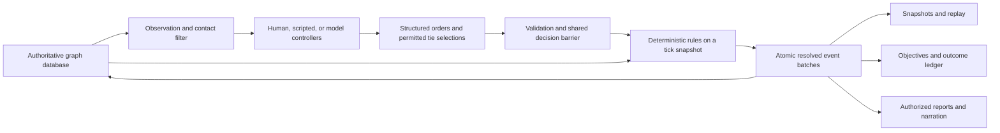

# Conceptual state, event, and outcome model

These are logical records and invariants for the confirmed graph-database architecture. Graph product, query language, and implementation language remain open. See [graph and inference boundary](10-graph-and-inference.md) for relationships, transaction rules, and bounded inference.

## Proposed information flow



Controllers read the filtered view. Replay and diagnostic access to authoritative events is a separate privilege. The diagram describes responsibility boundaries, not separate network services.

Graph state and its event batch share one logical commit boundary. The graph database stores canonical committed state; snapshots, arrays, indexes and other runtime views are derived from a specified graph version. Events provide the audit/reconstruction record. Independent writes to graph and event history are forbidden; the eventual implementation must demonstrate atomic recovery or equivalent guarantees before selecting its commit mechanism.

## Separate definitions from instances

| Record | Essential contents |
| --- | --- |
| `UnitArchetype` | Versioned historical identity, period, organization, weapon/role cohorts, capacity, mobility, doctrine defaults, source references, uncertainty |
| `WeaponProfile` | Compatible ammunition/targets, firing and reload behavior, range-dependent effects, crew requirements, source provenance |
| `ScenarioDefinition` | Map and scale, initial units/inventory, environment, fixed side relations, objectives, time limits, supported capability set, rules versions |
| `BattleState` | Run identity, simulation time, units, environment overlays, active effects, scheduled events, objectives, controller registry |
| `EnvironmentDefinition` / `EnvironmentState` | Preset map, location/climate context, date/season/time, initial surface and atmospheric conditions, fixed/scripted/variable weather policy, profile/version, recorded trajectory and optional seed; realized environmental changes remain distinct from observer reports |
| `MapSource` / `TerrainFeature` / `GridDefinition` | Source dates/attribution/hash, coordinate system and transform, alignment uncertainty, world-space grid origin/orientation/scale, reviewed feature geometry and physical attributes, provenance and historical corrections; issued map knowledge separate from terrain truth |
| `UnitState` | Archetype reference, original side and current authority, personnel accounts, location/footprint, equipment, inventory, condition, order progress |
| `ForcePool` / `PersonnelCohort` | Aggregate counts by role, proficiency and relevant condition, with available/assigned quantities; no named soldier records |
| `FormationTransition` | Versioned source/destination allocations for form, split, merge, remix or disband; effective time, resource/condition mapping and audit ID |
| `TrainingOrder` | Target cohorts/formation, skill objective, prerequisites, time/resource allocation, progress and deterministic completion effects |
| `CommanderState` | Parent, scope, delegated permissions, active mission, communication state, successor rule, controller identity |
| `CommandCapabilityProfile` / `CommunicationLink` | Versioned period/force/echelon tools and staffing; endpoint equipment/compatibility, medium, setup/operating state, capacity and delay; physical truth separate from known channel status |
| `StrategyIntent` | Player/system authority, objectives, priorities, risk limits, selected approach, revision and effective scope |
| `TwinContext` / `DelegationGrant` | Assisted player, authorized reports/preferences, advice versus execution permissions, recipients, order scope, duration and revocation state |
| `ContactState` | Observer scope, contact ID, last-known region/time, estimated identity/strength, confidence, evidence/source |
| `IntelligenceTask` / `IntelligenceAsset` | Issuing authority, question/area, aggregate unit or abstract asset, access/coverage, capacity allocation, duration, reporting constraints and lifecycle |
| `SpecialistAssignment` / `SupportTask` | Role/capability, field team/attachment/abstract asset, parent authority, assigned personnel/equipment and task capacity, mission lifecycle and service outcome |
| `StockReservation` / `Transfer` | Requested/reserved quantities, compatible stock, source/in-transit/destination accounts, carrier, timing and actual receipt/loss; reservation is not delivery |
| `IntelligenceReport` | Claims and uncertainty, source/provenance, collection/transmission/delivery times, recipients, coverage and confidence; hidden truth references are privileged and excluded from controller views |
| `Order` | Issuing actor and acting authority, strategy/mission reference, recipient, authority/order/observation versions, intent, constraints, superseded scope, delivery/execution lifecycle, fallback |
| `Dispatch` | Order/acknowledgment/report/request type, sender/recipient, linked evidence and mission/order, observation/event time, dispatch/relay/receipt times, channel, priority and authorized payload; receipt updates the recipient's knowledge rather than revealing the underlying event stream |
| `CivilianGroup` | Location, population accounts, mobility, shelter/needs, movement state; no combatant faction membership by default |
| `ObjectiveState` | Eligibility, area/target, progress/hold duration, contested state, visibility policy, completion evidence |
| `BattleResult` | End reason, per-side objective vector, personnel/equipment/supply ledger, control transitions, evidence references |
| `FrictionEpisode` | Mechanism/version, affected entities, shared cause, exposure, onset, persistent condition, recovery and evidence; latent threshold/draw identity only if justified sampling is enabled |

Use IDs for relationships and explicit versions for definitions. Immutable archetypes do not lose soldiers; their instances do. Avoid a giant mutable `strength` value or a deep subclass hierarchy for every historical troop name. Optional components can represent infantry, mounted movement, vehicles, ships, transports, or weapons without requiring every unit to have all fields. An entity-component storage library is not selected.

Formation IDs last for an active organizational instance; archived IDs preserve audit history, not a permanent playable character. Cohort IDs identify aggregate accounting buckets, never hidden individual rosters. Reorganizations carry allocations and provenance into successor formations while retiring or reducing predecessors. Personnel assigned to a formation cannot also remain available in a force pool. See [unit lifecycle](12-unit-lifecycle-and-training.md).

## Spatial and temporal data structures

- Cell map keyed by axial coordinate, with canonical indexing for iteration and a separate edge map.
- Occupancy/spatial index from cell or region to unit footprints and civilian groups; simple lookup first, partitioning after profiling.
- Directed command tree; separate graphs for traversable space, communications, and later logistics.
- Priority queue of scheduled events keyed by simulation time and explicit phase; equal-time interactions resolve as a batch, not arbitrary heap order.
- Dictionaries keyed by stable entity IDs; sort or otherwise define iteration where calculations depend on order.
- Contact stores scoped to observers; never a hidden truth dictionary with a cosmetic visibility flag.
- Append-only event batches plus periodic snapshots; projections for reports and player observations.

Initial naive sensing can be quadratic in units. That is acceptable for two units. Larger runs need range filtering, spatial indexes and cached terrain visibility. Command hierarchy reduces model decisions; it does not automatically reduce physics work.

## Event semantics

Event and outcome logging is a confirmed user requirement from the first headless duel. The structure below remains a design proposal; no logging implementation exists yet.

Commands express intent; events record adjudicated facts. `FireOrdered` is not `ShotResolved`. `OrderReceived` is not `ObjectiveCaptured`.

Proposed envelope:

```text
event_id, battle_id, sequence, tick, phase, event_type, schema_version
actor_ids, subject_ids, causation_id, correlation_id
visibility_policy, ruleset_version, payload
```

Events may include `OrderSubmitted`, `OrderRejected`, `OrderDelivered`, `MovementCommitted`, `ContactAcquired`, `FireCommitted`, `CasualtiesApplied`, `SuppressionChanged`, `ConditionTransitioned`, `SurrenderOffered`, `SurrenderAccepted`, `AuthorityRejected`, `ObjectiveProgressed`, and `BattleEnded`. Proposal/rejection audit records do not themselves alter combat state.

Record enough resolved values to rebuild state without recalculation or inference. For a combat effect, include contributing actions, rounds consumed, target cohort, resolved result (including draw identity if sampling is enabled), bounded personnel transfer, parameter/version references, and reason codes. Exact diagnostic detail can be retained in an authoritative audit stream while players see appropriately redacted events. Reports derive from these facts; this does not authorize an additional model narrator outside the confirmed inference boundary.

Commit all effects for a tick atomically. If a crash occurs mid-write, discard the incomplete batch or recover it exactly once according to a defined commit marker. No half-applied casualties or double-consumed ammunition on restart. Event IDs and order IDs support idempotence. A hash can detect divergent/corrupted state; it is not by itself proof against tampering.

## Required logging coverage

| Record family | What must be captured |
| --- | --- |
| Player/system intent | Mission, task, constraints, permitted discretion, revision/cancellation and issuer |
| Twin assistance and delegation | Authorized evidence, proposed approach/order, player selection or edit, grants/revocations and actual issuing actor; a draft is not a transmitted order |
| Order lifecycle | Submitted, validated/rejected, transmitted, received, accepted, started, superseded and completed/failed, with reasons |
| Agent decisions | Observation/mission version, delegated authority, chosen local order or tie selection, brief stated rationale, adaptation trigger and fallback use |
| Battlefield events | Movement/contact changes, committed fire, resource consumption, casualties, suppression, readiness/morale transitions and relevant terrain/environment changes |
| Reports | What a commander reported or requested, its evidence/observation time, send/delivery time and recipients |
| Intelligence | Scout/spy tasking, allocated capacity, evidence collection, report delivery, provenance and contradictions; assessments remain distinct from facts and link to resulting decisions |
| Mission outcomes | Progress and success, partial success, failure, cancellation or still-pending status under declared criteria, with supporting event references |
| Battle outcomes | Termination/truncation reason, per-side result vector, final state/version and objective-rule evidence |
| Technical audit | Model/configuration references, validation errors, timeouts, retries, interrupted commits and replay checks |

For future supported features, include training/reorganization, naval damage, civilian effects and campaign transitions under the same contract. Logging remains at formation/cohort/system granularity; it does not introduce individual soldier identities or require a separate event for every projectile.

Each essential record includes run/battle/branch ID, stable record ID, simulation time and phase, entity/order/mission references, schema/rule versions, and visibility scope. Record wall-clock timestamps separately for diagnostics; they cannot determine simulated action priority. Effect records contain the committed deltas or sufficient state payload to reconstruct them. Decision records link to the exact authorized observation supplied to the agent, not the later omniscient state.

Use parent/cause references to connect **selected strategy → mission → local decision → action → effect → evaluated outcome**. Link twin advice to a selection only when used; keep unselected drafts distinct. Direct interventions record authority checks, transport status, accepted override scope and the orders they supersede, including stale messages rejected later. Allow several contributing causes where necessary. Graph links describe recorded rule dependencies; they do not prove that an agent's stated rationale was correct or establish a counterfactual explanation of victory. Store brief decision explanations, not private chain-of-thought. Final outcomes are computed from rules and evidence, not model narration.

Illustrative chain: `OrderDelivered` → `ContactReported` → `PlanRevised` → `MovementCommitted` → `ObjectiveProgressed` → `MissionOutcomeEvaluated`. A separate `ReportDelivered` may occur later. The log must let a reviewer distinguish what happened, what the agent knew when it chose, and what the player knew when issuing the next order.

### Durable record and player-facing views

Maintain an authoritative append-only record and derive observer-scoped battle journals, timelines, decision traces and after-action summaries. Player-facing views preserve fog of war; full diagnostic access is a separate privilege. Retired formation IDs remain resolvable in history without keeping their agents alive. Corrections use explicit superseding records or new versioned analyses, not silent edits to the original trace.

Every completed run saves its manifest, initial graph/snapshot, accepted decisions/orders, committed event batches, final snapshot and structured outcome. An aborted run preserves its committed prefix and a technical status where storage permits; it must never be presented as a completed tactical result. If essential logging cannot commit, do not continue committing world changes without their history. Resume from the last verified commit or stop with a recoverable technical failure.

Essential decisions, state changes and outcome evidence cannot be dropped by sampling or log-level settings. Optional performance/debug detail may be reduced. No-op ticks need not create narrative events, but time progression, scheduled work and numerical accumulators must remain reconstructible. Storage format, retention policy and graph product remain open design choices.

## Replay and storage choices

Event sourcing supports reconstruction but adds schema-evolution and operational complexity. [S21](09-sources.md#s21) Use its useful properties in the simulation boundary without assuming the entire future web app needs an event-sourced architecture or a distributed message broker.

Distinguish:

1. **Event playback:** apply saved resolved events to reconstruct what happened; no RNG or agent calls.
2. **Deterministic re-simulation:** run the pinned kernel from the initial graph state, accepted commands, accepted tie selections and seed if sampling is enabled; compare event/state hashes.
3. **Counterfactual branch:** change orders or parameters, preserve parent run reference, and produce a new result.
4. **Fresh agent evaluation:** call controllers again; same combat seed does not imply the same decision trace.

Snapshot includes the event offset, canonical state, pending scheduled events, active order progress, RNG state/key scheme, and relevant versions. A saved visible map alone cannot resume a battle. Keep old readers or explicit migrations for event/schema changes; never silently rewrite historical outcomes to fit new rules.

## Conservation and legality

Within a fixed personnel cohort, accounts are mutually exclusive: fit, wounded-present, killed, captured, missing/deserted, and evacuated/exited. Routing troops remain living personnel, not casualties. Campaign records retain aggregate health/availability categories after exit or capture, without tracking individual soldiers.

`initial_personnel + arrivals = fit + wounded_present + killed + captured + missing_or_deserted + evacuated_or_exited`

Other invariants:

- Ammunition before + transfers in = rounds fired + transfers out + losses + ammunition after.
- One person/weapon cannot be assigned to incompatible simultaneous activities or counted in two units.
- Weapon operation respects available crew, reload state, ammunition type, and damage.
- Split/merge/remix and embark/disembark conserve aggregate personnel, equipment, inventory and relevant condition, with traceable source allocations. Formation identity may change; no individual identity tracking is required.
- Movement honors terrain, distance/time, occupancy and domain; dead/routed/captured state is not a teleport shortcut.
- A unit has one effective authority at a time; command graphs contain no cycles.
- No event applies twice; simulation time never decreases in one run.
- Objective awards are idempotent and supported by explicit events.

## Outcome and victory management

Declare a scenario's end predicates and objective evaluation order before play. Evaluate all sides from the same committed tick; do not check side A's victory midway through side B's damage processing.

Possible end reasons: objective completed, scenario deadline, withdrawal beyond a defined boundary, accepted surrender, all required participants unable to continue, or explicit technical abort. A technical abort or harness budget limit is a **truncation**, not an enemy victory. Mutual destruction, simultaneous completion, tied scores, and contested control need declared rules. Three-sided battles may produce joint winners or partial mission success; do not force every result into a binary winner.

Proposed outcome vector per side:

| Category | Examples |
| --- | --- |
| Mission | Hold duration, crossing achieved, extraction completed, time bought |
| Force | Fit survivors, wounded, killed, captured, missing, equipment remaining |
| Condition | Morale/cohesion/fatigue at end; units routing or rejecting authority |
| Resources | Rounds spent, stocks remaining, supplies lost |
| Civilian/infrastructure | Casualties, displacement, shelter disruption, bridge/building damage |
| Command | Orders delivered/completed/refused, delay, lost contact, fallback use |
| Technical | Simulated duration, wall time, model calls/usage, validity and replay hashes |

A scenario may derive a score from the vector, but retain the vector and source events. Never let an LLM choose the winner after reading a narrative. Avoid kill-only rewards that encourage exterminating an already-defeated unit or ignoring the mission.

Handle stalemate with a declared deadline and a report of why neither side progressed. An early-stalemate detector must consider pending orders, projectiles, scheduled reinforcements, recovery, and future objectives; “no casualties for several turns” is insufficient.

## Worked simultaneous case

Illustrative: at tick 120, both platoons have loaded weapons and an authorized target. Each commits ten rounds. Resolved effects incapacitate two members of A and one of B. Both fire actions remain valid because eligibility was determined together. Tick 121 uses the reduced fit counts. If A had already been incapacitated at tick 119, it could not fire at 120. This fixture tests batching without asserting a historical casualty rate.
