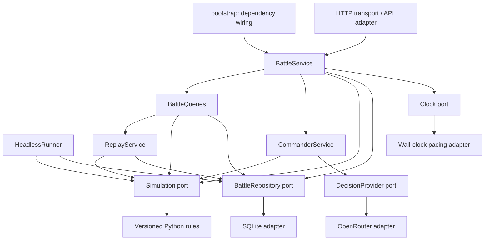

# Service architecture and dependency injection

**Current layout:** POC code and commands below are relative to `apps/poc/`. See [monorepo layout](28-monorepo-and-stack-direction.md) and the [POC run guide](../../apps/poc/README.md).

Date: 2026-11-05. Status: implemented local architecture refactor. Source: The user's requirement that even the demo use structured code, DI, service-oriented architecture and separation of concerns to simplify conversion. No external research claims are introduced.

## Decision

Use a modular application with explicit service contracts and constructor injection. Services currently run in one Python process. A composition root selects concrete implementations. The HTTP adapter, CLI/headless runner and browser components consume these boundaries rather than constructing storage or invoking a model from request/rendering code.

This refactor retains the existing `poc-8` rules and persisted snapshot/action format. It changes application organization, not combat parameters. Old rule editions remain frozen. Existing saves do not require Reset for this architecture update.

## Responsibilities and files

| Boundary | Implementation | Responsibility |
|---|---|---|
| Contracts | `battle/contracts.py` | Protocols for repository, simulation, provider, commander, scenario catalog, clock/factory; shared conflict/audit errors |
| Composition | `battle/bootstrap.py` | Constructs concrete dependencies once; separate interactive, replay and headless wiring |
| Configuration | `battle/config.py` | Immutable settings loaded at startup; credential excluded from object representation |
| Command service | `battle/services/battle.py` | Current battle identity, revision checks, command serialization, pause/advance, decision cadence and one atomic commit |
| Decision service | `battle/services/commander.py` | Authorized observations, bounded model proposals, engine validation, deterministic fallback, staff consultation |
| Query service | `battle/services/queries.py` | Commander/God projections, HQ-only analysis, history, replay views and completed-battle audit gate |
| Replay service | `battle/services/replay.py`, `battle/replay.py` | Recorded inputs plus injected transitions; no provider, configuration or clock requirement |
| Headless use case | `battle/services/headless.py` | Scripted battle using the same repository/simulation/commander contracts |
| Rules integration | `battle/adapters/rules.py` | Exposes current and frozen Python rules through the simulation port; scenario/map catalog |
| Pure command policy | `battle/command_policy.py` | Observer projection, permitted mission schemas and scripted order selection |
| Provider adapter | `battle/adapters/openrouter.py` | HTTP serialization, credentials, timeout, bounded response read and sanitized provider failures; injectable HTTP transport |
| Persistence adapter | `battle/storage.py` | SQLite state/events/decisions/messages in one compare-and-swap transaction |
| Clock adapter | `battle/clock.py` | Wall-time pacing of an injected step callback; separate from simulation time/physics |
| HTTP | `battle/server.py`, `battle/adapters/http_api.py` | Request parsing, host/origin/static-file boundaries, error/status mapping and route-to-use-case translation |
| Browser transport | `static/api-client.js` | Injected fetch transport, JSON requests and error decoding |
| Assessment component | `static/troop-analysis.js` | Injected UI context, DOM accessor, display helpers and dispatch callback; owns draft/render state only |
| Browser composition/controller | `static/app.js` | Wires browser dependencies and existing map/unit/clock/replay interactions |

Application services import contracts and pure policy/presentation code, not SQLite, HTTP clients, configuration readers or concrete adapters. No DI framework or service locator is needed. Constructors expose dependencies plainly; production code is wired at startup and tests pass substitutes directly.

## Write and decision flow

1. HTTP translates a URL into an application command name. It does not choose tactics, construct SQL or apply an order directly.
2. `BattleService` checks the selected game, expected revision and clock state. It rejects commands promptly during an outstanding interval, then rechecks after taking its serialization lock.
3. If a decision is due, `CommanderService` obtains the side's authorized observation through `Simulation`. The provider sees only that projection, never the ground-truth snapshot, store or command-writing capability.
4. Proposed orders are validated by the simulation contract. Provider failure or an illegal result selects the existing deterministic fallback. Staff proposals remain proposals until explicitly dispatched.
5. `Simulation.apply` creates the next snapshot from the accepted action. The versioned rules still adjudicate every effect and log essential events.
6. `BattleRepository.save` atomically commits state, events, decisions and derived messages at the expected revision. Failure leaves the prior committed state intact; services never write those records separately.

Pause remains available during a slow provider call. The in-flight interval may complete once, with no catch-up burst. Repository revision checks remain necessary even with a process lock, so a later adapter cannot rely on the current single-process deployment for integrity.

## Read and replay flow

Queries project committed state. Staff assessment always uses headquarters knowledge, including in God Mode. Replay uses recorded actions through the injected simulation and compares every resulting snapshot. It has no commander/provider dependency and cannot accidentally generate new model decisions.

The repository contract returns detached snapshot documents. Historical revisions remain immutable. The in-memory test implementation and actual SQLite adapter run the same copy-isolation, immutable-history and stale-write tests. Fault-injected SQLite tests also exercise the application command path.

## Compatibility and migration

The old `server.Application(...)`, `inference` function API and `runtime.verify_replay(...)` remain small compatibility facades for earlier callers/tests. New application code uses the services and composition root. Legacy inference construction is confined to that facade; it is not the production request path. Existing HTTP routes and payload shapes are retained.

Snapshots and actions remain versioned JSON dictionaries. This deliberately preserves replay; it is not a claim that every nested domain entity now has a fully typed schema. Python protocols type service interfaces; a future schema migration must define codecs/versions explicitly. Current domain rules retain their tested module organization and frozen edition dependencies.

To change the database, implement the repository contract and its atomic event/state persistence semantics, then wire that adapter in `bootstrap`. A graph-backed store will still need its own normalized model, indexes, transaction design and real-store integration tests; changing a constructor does not design that model.

To change the model host, implement `DecisionProvider` and inject it. To change deployment transport, provide a new adapter to the application services. To replace the frontend, preserve its HTTP contracts or introduce a versioned transport adapter. Further browser views can follow the extracted assessment-component pattern; the existing map/unit controller has not been rewritten into a new UI framework.

Remote services are a later deployment choice. Distributing these boundaries would additionally require authenticated player ownership, idempotent command delivery, distributed coordination and failure recovery. This local refactor does not implement multiplayer authorization, an event broker, remote inference orchestration or Evo deployment.

## Verification

180 Python tests pass, including 20 new service/adapter/architecture tests. They exercise injected memory storage, clock and provider; limited observations; illegal model output/fallback; private-error suppression; stale revisions; save failure; query/replay isolation; pause during blocked inference; reset history; staff proposals; shared SQLite/memory repository contracts; settings; injected HTTP provider transport; and import-boundary checks.

The existing HTTP and browser-controller smoke suites pass, including orders, standing doctrine, recommendations, split/combine, clock, God Mode, map and replay. Geometry checks still cover 504 cells, physical scale and SVG fallback.

The new headless composition completed game `ebb2e70d9d654e59` in `/tmp/battle-services-headless.sqlite`: 60 turns, 2,562 events, 63 identical replay revisions, with the same final aggregate strengths as the prior `poc-8` baseline. Existing saved battles across earlier editions and current standing-order previews also replayed identically. No new live-model evaluation, historical calibration, Evo execution or deployment is claimed.

Final browser verification used isolated game `ea9ae496a6b14ef1`: the extracted assessment component dispatched a firm standing order through the new application service; starting the clock delivered it, and the read model displayed version 1. The game paused at turn 1/revision 2, and all three snapshots replayed identically. [Runtime screenshot](../../apps/poc/artifacts/battle-services-verified.png). The test server was stopped; the main app remains running with its original `poc-3` game paused at turn 4/revision 4. Final checks: 180 tests passing and no critical Python lint findings in the refactored modules.
