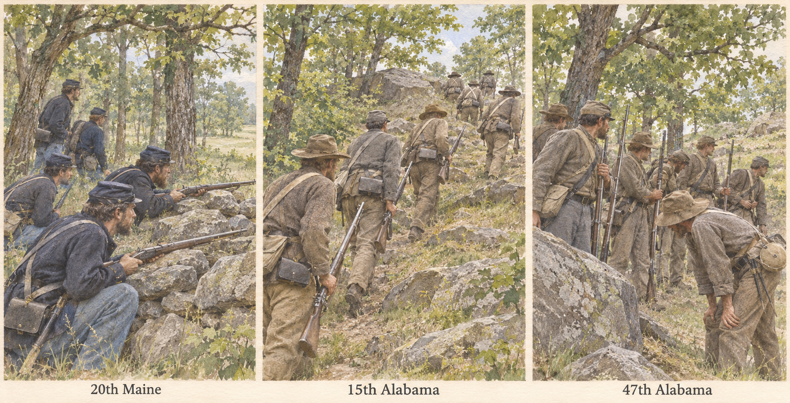

# The units at Little Round Top

**Gettysburg, Pennsylvania · July 2, 1863.** The playable scenario borrows three regimental names. Its six 40-person detachments, equipment counts, morale and starting positions are authored. This field guide gives the next scenario edition historical company identities where the evidence supports them. Source review and original illustration dated November 5, 2026.

*Inferred rendering.* The wall in the Maine scene comes from Captain Morrill’s account. Oates describes the rocky approach and the difficulty of keeping neighboring regiments aligned. Clothing, faces, poses, the number of figures and exact positions are illustrative. The Alabama clothing palette draws on a published living-history reconstruction of the 15th. The 47th’s clothing is an analogy. Use the archive links below for the flags. [NPS landscape report, fig. 4.13 and accompanying testimony](https://www.nps.gov/gett/getinvolved/upload/FinalCLR_LittleRoundTop_AllSections-508.pdf) · [Oates’s report, August 8, 1863](https://www.nps.gov/gett/learn/historyculture/official-report-of-colonel-william-c-oates.htm) · [Liberty Rifles impression notes](https://www.libertyrifles.org/research/impression-archive/15th-alabama-gettysburg)

## Company identities and composition

| Historical formation | What the evidence supports | Representation for a new scenario |
|---|---|---|
| Company B, 20th Maine Volunteer Infantry | Col. Joshua L. Chamberlain detached Capt. Walter G. Morrill’s infantry company to guard the exposed flank. Morrill describes roughly 12–15 U.S. sharpshooters under an NCO joining him and taking cover with the company at a stone wall. The range counts the attachment only. | Give the skirmishing mission to Company B. Keep the main line and headquarters as separately labeled detachments of the 20th Maine. The simulation can account for the sharpshooters as a temporary attachment when they join. [Chamberlain’s report](https://gettysburg.stonesentinels.com/union-monuments/maine/20th-maine/official-reports-for-the-20th-maine-at-gettysburg/) · [Morrill’s account, NPS fig. 4.13](https://www.nps.gov/gett/getinvolved/upload/FinalCLR_LittleRoundTop_AllSections-508.pdf) |
| Companies B and G, 15th Alabama Infantry | The regiment comprised ten infantry companies. B was the Midway Southern Guards, recruited in Barbour County. G was the Henry Pioneers, from Henry County. Col. William C. Oates names men from both companies in his account of the approach. | These are eligible named companies on the attacking side. “Pioneers” is a company nickname. Assign infantry capabilities. Oates describes movements by the regiment, so any separate company route or effective count still needs its own source or an explicit scenario assumption. [Oates’s report, first fence encounter](https://www.nps.gov/gett/learn/historyculture/official-report-of-colonel-william-c-oates.htm) · [Company list and recruiting counties](https://www.libertyrifles.org/research/impression-archive/15th-alabama-gettysburg) |
| 47th Alabama Infantry, Law’s brigade | The regiment included Company B, the Tallapoosa Light Infantry, and Company C, the Jeff Holly Guards. Oates places the regiment on his left and describes its withdrawal. That observation establishes the regiment’s position. | Label the neighboring body “47th Alabama Infantry detachment” until a company-specific record anchors it to that ground. The company names belong in the historical profile. The scenario’s scout role is an authored assignment. [Ohio State eHistory, 47th company list](https://ehistory.osu.edu/exhibitions/Regimental/alabama/confederate/lawsbrig) · [Oates’s report](https://www.nps.gov/gett/learn/historyculture/official-report-of-colonel-william-c-oates.htm) |

The present U2 is both the authored “B” detachment and player headquarters. Renaming it Morrill’s Company B in place would put the player with the skirmishers and give that company incompatible orders. In a new scenario definition, link the flank element to Morrill and keep the player with the main line. Preserve old saves and recorded orders. Actual effective company strengths remain open pending dated returns or muster evidence. Historical rosters, establishment strength, and the count on hand at a specific hour are distinct quantities.

## Standards and colors

| Unit | Standard to show in its historical profile | Use on the July 2 field |
|---|---|---|
| 20th Maine | The regiment’s U.S. national color. Maine identifies the Gettysburg flag, and the veterans’ reunion account describes the old color at Little Round Top. [Maine Atlas artifact](https://www.maine.gov/sos/maineatlas/explore-the-atlas/joshua-lawrence-chamberlain) · [Photograph of the exhibited national color](https://maineroadstogettysburg.com/2018/01/04/flag-day/) · [Veterans’ account](https://www.maine.gov/civilwar/books/Reunions_of_the_Twentieth_Maine_Regiment.pdf) | Identify it at regimental level. A company can link to its parent’s colors. Its detached skirmishers receive no flag of their own without evidence. |
| 15th Alabama | The archives photograph identifies a surviving battle flag of the 15th. A material-culture history follows its service into 1864. [Archive photograph, accessible copy](https://commons.wikimedia.org/wiki/File:15th_Alabama_Infantry_flag.jpg) · [Flag provenance discussion](https://emergingcivilwar.com/2020/10/07/the-pink-confederate-battle-flags/) | Record the regimental association. Leave carriage and appearance on July 2 unverified. Later honors or repairs to a surviving flag require their own dates. |
| 47th Alabama | The New York State Military Museum catalogs a first-national-pattern flag with 15 appliquéd stars, accession **1995.0303**, as *probably* the 47th’s. It was captured at Antietam on September 17, 1862. [Museum photograph and catalog entry](https://museum.dmna.ny.gov/flags/other/confederate/47th-alabama-infantry-probable-national-civil) | Offer the artifact in the regiment’s earlier history. It was already on display in New York in June 1863. Leave its Gettysburg replacement open. |

## What the project should implement

1. Put a **Historical unit** section in the existing inspection panel. Show dated name, parent formation, company nickname, tactical role, documented personnel and attachments, associated colors, illustration and sources. Show strength *in this simulation* beside its effective time. Keep historical estimates and assigned starting values separately labeled.
2. Record provenance for each claim. Each source needs a URL or archive locator, the claim it supports, the date the claim applies to, and whether it is documented, inferred, or authored for play. A standard has a holding institution, object identifier where known, owning echelon, attribution confidence, service dates, evidence for the action, and reproduction rights. Display museum links while image-reuse rights are unresolved. Allow “unknown”, “documented absent” and “not applicable”.
3. Use the same profile contract in later land and sea scenarios. A flag, guidon or ensign belongs to the echelon or vessel that carried it in the relevant period. Keep unit art and colors out of combat ratings. An unidentified contact gets a neutral marker and sighting estimate. Reveal a named enemy profile only after identification reaches the observer. Localized captions must identify inferred art.
4. Preserve aggregate personnel when attaching, detaching, splitting or combining. A split can inherit a parent's historical affiliation, but only the formation carrying its physical color retains that object. Verify this with component tests alongside stale contact reports, unknown company counts, out-of-period flags, inspection permissions and old-save replay.
