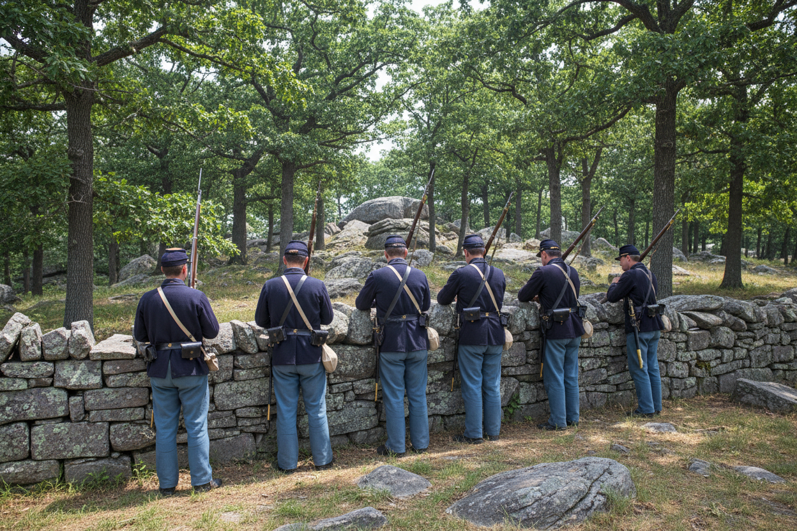

# OpenRouter unit image pilot

On November 5, 2026, a standalone probe loaded the POC’s existing server-side settings and submitted the [exact request](../../apps/poc/skills/illustrate-unit/example-request.json) to OpenRouter at `POST /api/v1/images`. The live public catalog listed image output, one image per request and the requested 3:2 ratio for the model. [OpenRouter image generation](https://openrouter.ai/docs/guides/overview/multimodal/image-generation) · [Gemini 2.5 Flash Image](https://openrouter.ai/google/gemini-2.5-flash-image)

| Evidence | Observed value |
|---|---|
| Model requested | `google/gemini-2.5-flash-image` |
| Returned model field | Absent from response |
| Image | PNG, 1248 × 832 |
| SHA-256 of provider image | `30f7bcb43c964a772e44bab88e61daf356db21298c56eb002b58f55b334e7793` |
| Reported cost of this request | USD 0.038793 |

**AI reconstruction.** Captain Morrill’s account supplies the flank assignment and stone wall. Clothing details, spacing, figures and viewpoint are inferred. The [unit field guide](32-historical-units-and-colors.md) links the testimony. This run verified provider access. The project owns runtime integration and in-game verification of the [skill](../../apps/poc/skills/illustrate-unit/SKILL.md).
