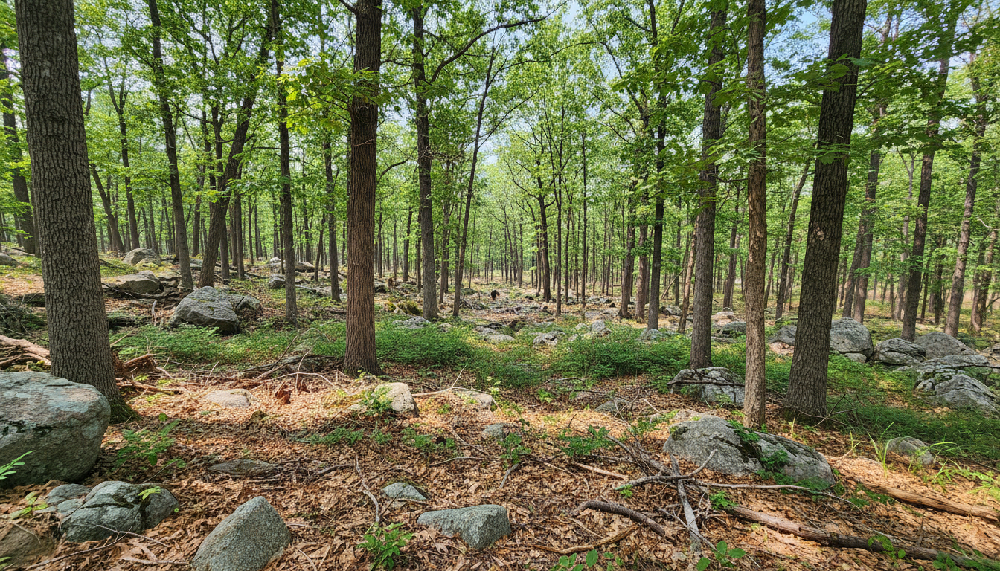
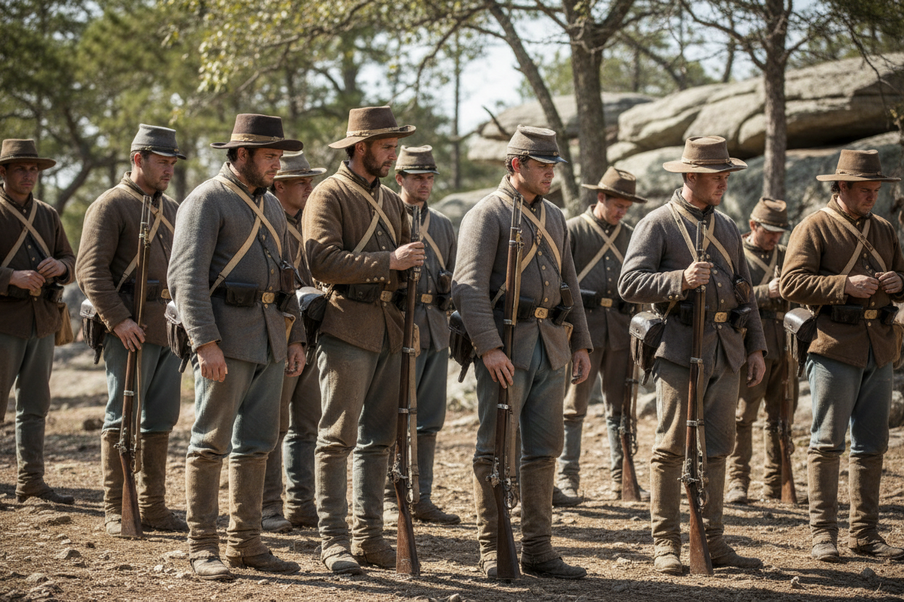

# Field glasses and unit appearance

The staged [binocular control and view skill](../../apps/poc/skills/field-glass/SKILL.md) are for the command map. Choose a bearing from HQ. A read-only sightline supplies near and far terrain, season, weather and only fresh local enemy observations. Visual range follows the scenario's period and equipment. A distant report is historical intelligence until delivered; it cannot open a live camera at the sender.

The local example uses 16:32 on July 2, 1863 in an isolated Gettysburg replay. The 196-degree sightline runs downhill four hexes (187 to 169 m) from rock to woods. The engine confirmed the observer’s low-confidence contact and no visible mapped structure in the selected cone. Three existing checks passed for obstruction, information isolation and observation quality. This is provider and fixture evidence; the in-game control awaits project integration.

The user authorized sending a short scene description to OpenRouter. IDs, coordinates, saves, dispatches and the local observation packet stay on this machine. The first permitted generation introduced an apparent track. A second described the continuous woodland more clearly and supplied the image above. The two image requests cost USD 0.0774709 together. Both requested google/gemini-2.5-flash-image. The responses supplied no returned model ID. The accepted PNG checksum is e4e4b5364a5beafcd11d51efa68ac90015a0f582441e6ab2774ac50bb3b29759.

For the unit gallery, use reproducible variation in documented clothing and eligible equipment, then apply the unit's known conditions. For example, dust may accumulate on an issued jacket during a reported dry march; its cut and the formation’s arms still come from the dated profile. In a field-glass view, permit only the level of detail the observer could resolve. See the [appearance rules](../../apps/poc/skills/illustrate-unit/SKILL.md#variation-in-dress-and-accoutrements) and [historical kit sources](32-historical-units-and-colors.md). Test that changing only the cosmetic seed leaves simulation and observation hashes unchanged, replay reuses the image, and an unidentified contact produces identical outbound text across hidden uniform changes.

The live gallery trial used the [reference sampler](../../apps/poc/skills/illustrate-unit/appearance.py) with equal illustrative weights for brown and grey jackets and a separate dry-march dust cue. The selected mix placed grey first and brown second. The seed reproduced its selection; multiple seeds varied emphasis; unresolved identity suppressed every clothing cue; changing only dust preserved the baseline. OpenRouter returned a 1248 × 832 PNG for USD 0.0387417, SHA-256 a85c960f0a94ee011ee8a7630f43413bc8ea4b5b5702ae5aa7ce63689d147e53. Counts and poses are illustrative.
